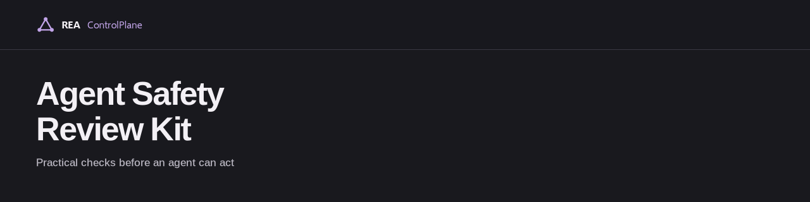

# Agent Safety Review Kit

Practical checks before an agent can act.

A vendor-neutral, docs-only kit for reviewing an AI agent before it is allowed to call tools, touch data, or take actions with real consequences. It is a checklist, a set of failure-scenario cards, and blank worksheets. It works without any product, account, SDK, or API key.

> Docs-only review resource. Content is licensed under CC BY 4.0; see [License](#license) for scope and brand exclusions.

## Who this is for

- Developers wiring an LLM agent to tools (shell, email, payments, tickets, file systems, internal APIs).
- Reviewers asked to sign off on an agent before it gets broader permissions.
- Teams that want a shared, written record of what an agent may do and what stops it.

## The problem

Agents fail in ways ordinary code review does not catch: a tool result tells the agent to do something, a retry loop repeats a payment, a key ends up in a log, or nobody can stop a run halfway. Most of these are permission and process questions, and they are easier to answer before launch than after an incident.

## How to use it

A short path for an initial review. Read it once, then go deeper where you find gaps.

1. Skim the [checklist](docs/checklist.md) and mark each section as applies / does not apply.
2. Pick the [scenario cards](docs/scenarios.md) that match your agent's tools. Each card lists what can go wrong and what to check.
3. Copy the [blank review record](templates/review-record.md) and fill it in for one agent and one environment.
4. Compare with the [hypothetical filled example](examples/hypothetical-review.md) to see the level of detail intended.
5. Attach evidence (config excerpts, test notes from a non-production environment, approval screenshots) and list open gaps with owners.

## What is in the kit

| Path | What it is |
| --- | --- |
| [docs/checklist.md](docs/checklist.md) | Review checklist grouped by control area |
| [docs/scenarios.md](docs/scenarios.md) | Failure-scenario cards with checks and evidence ideas |
| [templates/review-record.md](templates/review-record.md) | Blank review and evidence worksheet |
| [examples/hypothetical-review.md](examples/hypothetical-review.md) | One filled example for a fictional agent |
| [SECURITY.md](SECURITY.md) | How to handle security-sensitive feedback |
| [CONTRIBUTING.md](CONTRIBUTING.md) | How to suggest changes |

## A review is not enforcement

This kit helps you ask and record questions. It does not stop an agent from doing anything. Enforcement happens at runtime: in the permission system, the tool gateway, the credential scope, the approval service, the budget limiter. A completed checklist is a snapshot of what reviewers believed and saw at one point in time; it can drift from the deployed system the next day. Re-review when tools, prompts, models, permissions, or environments change.

## Limitations

- No certification, attestation, or compliance claim of any kind. Completing the kit does not make an agent safe or compliant with any standard.
- No security guarantee. The checklist is not exhaustive and will miss threats specific to your system.
- Not a substitute for threat modeling, security review, penetration testing, or legal advice.
- Vendor-neutral by design; it does not evaluate any specific product.
- Exercise risky or destructive cases only in isolated, non-production environments with fake data and revocable test credentials. Never test them in production.

## Related public references

These are independent sources reviewers may find useful. Listing them is not an endorsement by or of their authors, and this kit is not derived from or affiliated with them.

- OWASP Top 10 for LLM Applications: https://genai.owasp.org/llm-top-10/ (see especially prompt injection, sensitive information disclosure, and excessive agency)
- NIST AI Risk Management Framework: https://www.nist.gov/itl/ai-risk-management-framework

## About

Maintained by REA Research Labs. REA builds ControlPlane, runtime control and security for AI agents: https://reacontrolplane.com. The kit is vendor-neutral and requires nothing from REA.

## License

Copyright 2026 REA Research Labs, Inc. Prose, checklists, templates, and the fictional example are licensed under CC BY 4.0. See [LICENSE](LICENSE) and [license scope and brand exclusions](LICENSE-SCOPE.md). Logo/banner artwork is excluded; trademark rights are reserved.

Organization: https://github.com/REA-Research-Labs-Inc. Repository: https://github.com/REA-Research-Labs-Inc/agent-safety-review-kit. For sensitive flaws in this kit's guidance, follow [SECURITY.md](SECURITY.md). GitHub private vulnerability reporting is enabled. Never include sensitive reports in public issues.
